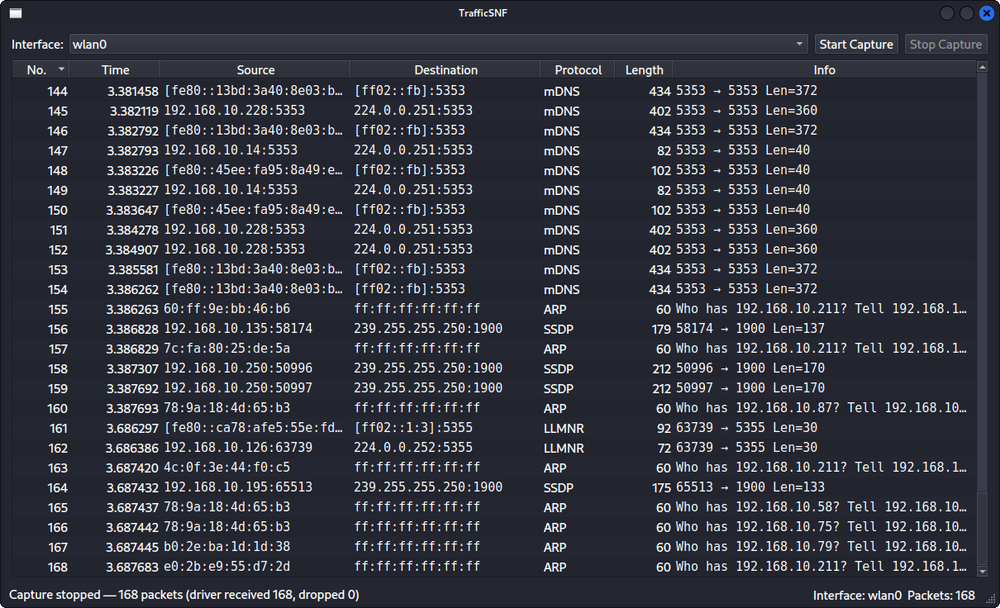

# TrafficSNF

A lightweight real-time packet sniffer with a native desktop GUI, written in C++17 and Qt 6. Think "Wireshark's packet list, but small enough to read in one evening."

<p align="center">
  
</p>

## Features

- Lists network interfaces and captures live traffic on the one you pick
- Capture runs on its own thread, so the UI stays responsive at high packet rates
- Dissects packets on the fly:
  - **L2:** Ethernet II, 802.1Q VLAN tags, loopback / null link types
  - **L3:** IPv4, IPv6 (including extension headers), ICMP / ICMPv6 with readable type names, IGMP, GRE, ESP, AH, OSPF, SCTP
  - **L4:** TCP (ports, flags), UDP
  - **L7 (by port and payload):** DNS, mDNS, LLMNR, DHCP, SSDP, HTTP, TLS (record type detected from the payload, not just the port), QUIC, SSH, SMB, RDP and about 40 other common services
- Sortable packet table that auto-scrolls only while you're at the bottom, so you can stop and read without it jumping away
- Driver statistics when the capture ends (packets received / dropped by the kernel)
- Truncated or malformed packets still show up as rows instead of being dropped or crashing the parser

## Architecture

```
src/
├── main.cpp
├── mainwindow.{h,cpp,ui}      # Qt Widgets UI: interface picker, start/stop, status bar
└── core/
    ├── sniffer_worker.*       # pcap capture loop on a QThread, batches packets
    ├── protocol_parser.*      # bounds-checked dissector (Ethernet → IP → TCP/UDP/ICMP → app hint)
    ├── packet_table_model.*   # QAbstractTableModel: batched inserts, index-based sorting
    └── packet_types.h         # DissectedPacket, LayerInfo
```

How a packet moves through it:

1. `SnifferWorker` runs `pcap_loop` on a dedicated thread. `pcap_breakloop` is called under a mutex when you press Stop, so the handle is never closed while in use.
2. Each packet is dissected **on the capture thread**, so the GUI thread never parses bytes.
3. Dissected packets are collected and emitted in **batches (every ~40 ms)** through a queued signal.
4. `PacketTableModel` inserts each batch with a single `beginInsertRows` / `endInsertRows`, which is what keeps the table smooth under load.

The parser never reads past the captured length. Every layer checks the remaining bytes before touching them.

## Requirements

| Component | Version |
|-----------|---------|
| C++ compiler | C++17: MinGW-w64 (GCC 13+) or MSVC |
| Qt | 6.2+ (Core, Gui, Widgets) |
| CMake | 3.16+ |
| Npcap (driver) | installed, with WinPcap API-compatible mode |
| Npcap SDK | headers and libs, from <https://npcap.com> |

Developed and tested on Windows 11/Kali Linux Build

```bash
git clone https://github.com/AbdulatifYusupov/TrafficSNF.git
cd TrafficSNF
cmake -S . -B build -DPCAP_ROOT=C:/npcap-sdk
cmake --build build
```

`PCAP_ROOT` should point at the unpacked Npcap SDK. If you leave it out, CMake looks in `C:/npcap-sdk` and `C:/Program Files/Npcap SDK`, and you can also set it as an environment variable. If Qt isn't found, add `-DCMAKE_PREFIX_PATH=C:/Qt/6.x.x/<kit>`.

Run `build/TrafficSNF.exe`, pick an interface, press **Start**.

If the interface list is empty, Npcap isn't installed or you lack permission to open capture devices. Reinstalling Npcap and running the app as Administrator are the two usual fixes.

## Legal

Only capture traffic on networks you own or have explicit permission to monitor. Packet captures can contain passwords, cookies and other private data.
